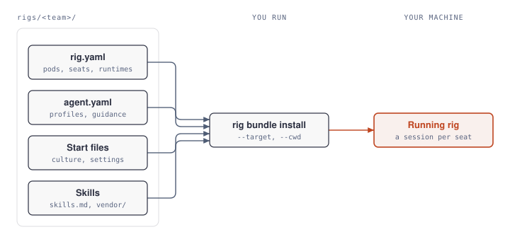

# openrig-rigs

Teams for [OpenRig](https://github.com/mvschwarz/openrig), each a folder under `rigs/` that installs as a bundle. The
words these docs use, such as team, rig, seat and slice, are in the [glossary](GLOSSARY.md).

| Team | What it is |
|---|---|
| [`rigs/shipwrights`](rigs/shipwrights) | An engineering team built on OpenRig's Workshop. Its fourteen seats (a lead, a planner, backend and frontend builders, a QA seat for each builder, two pairs of reviewers and a release manager) take a goal to judged pull requests that are ready to merge. |

Each team's README says how to install it.

## Working on a team

A team is a folder of files, and two commands turn it into a running rig: `rig bundle install` starts its seats from
`rig.yaml`, `agent.yaml` and its start files, and `install-skills.sh` installs the skills its `skills.md` names.

<picture>
  <source media="(prefers-color-scheme: dark)" srcset="docs/diagrams/team-to-rig-dark.svg">
  
</picture>

A team ships no third-party skills. Its `skills.md` lists the ones its guidance names, with each one's source, a
suggested commit and its licence, and `install-skills.sh` installs them for Claude Code and Codex at user level.

`scripts/check-team.py rigs/<team>` checks a team against what its README promises; the script's docstring lists every
check. Set `TEAM_BLOCKLIST` to a comma-separated list of words the team must never contain, such as names from the
setup it was first built for.

`docs/diagrams/build.py` generates the diagrams, here and in each team's folder. To change one, edit its geometry
there and run the script; an SVG edited by hand is overwritten on the next run.
