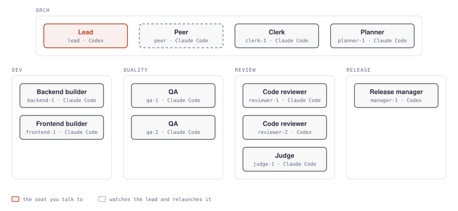
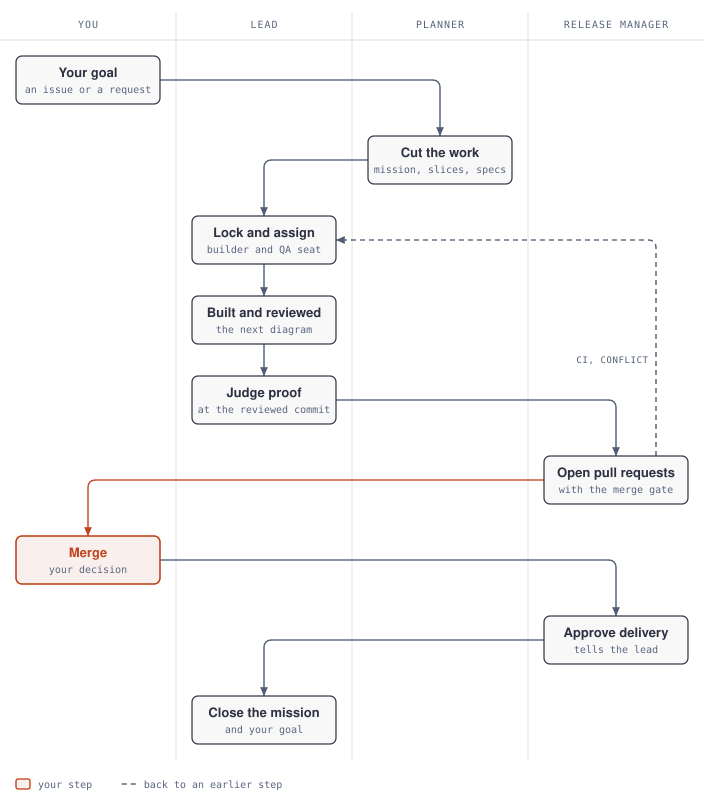
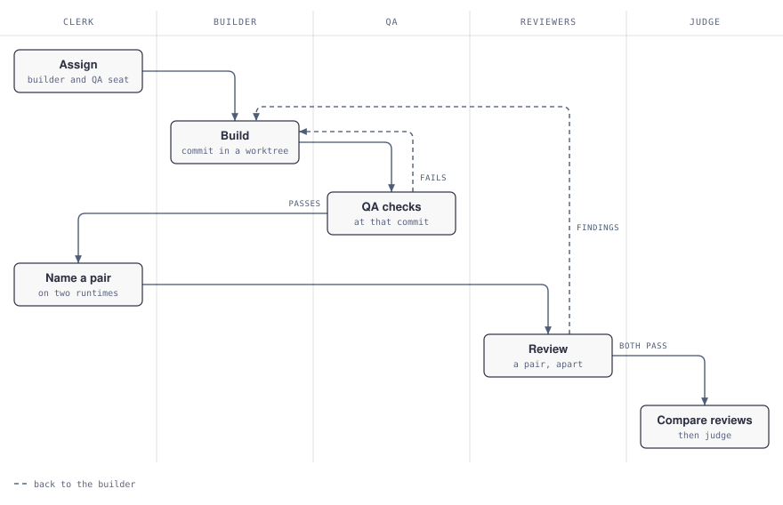
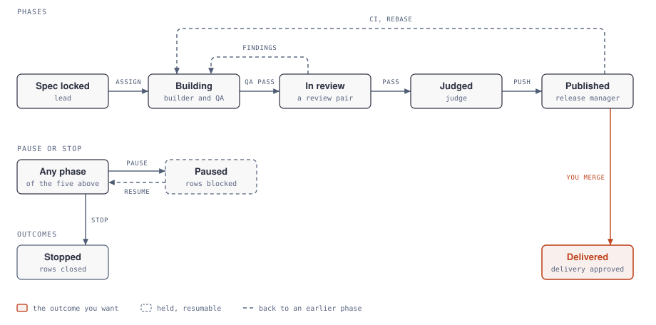
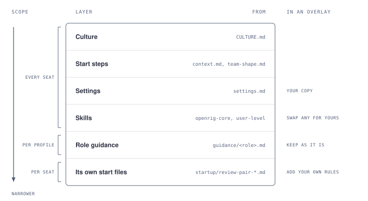

# Shipwrights

An engineering team for [OpenRig](https://github.com/mvschwarz/openrig). You give it a goal, and it comes back with
pull requests that have been planned, built, tested and reviewed, for you to merge. It works in a clone of one
repository, or in a folder that holds clones of several, and follows each repository's own `AGENTS.md` there.

## Why Shipwrights rather than Workshop

Shipwrights starts from OpenRig's
[Workshop](https://github.com/mvschwarz/openrig-world/tree/d544888b4c9973164e7986d7e0344a7ceca89a8c/rigs/workshop-review-pair)
team: a lead, one builder, a QA seat, and two code reviewers on different runtimes who review each commit without
seeing each other's findings. Shipwrights keeps that review pair, because I've had much better results from two
reviewers on different providers than from one, and changes the rest in four ways:

- **Code review with several skills.** Each review runs `code-review`, `ponytail-review` and `differential-review`, and
  adds Trail of Bits' checks when a change touches dependencies, APIs or CI workflows.
- **Built on Matt Pocock's skills.** Planning, building and testing follow his
  [engineering skills](https://github.com/mattpocock/skills) (`triage`, `wayfinder`, `implement`, `tdd`,
  `diagnosing-bugs` and others), with `impeccable` for UI work. [`skills.md`](skills.md) lists every skill and where
  it comes from.
- **More than one stream of work, from a small start.** A backend builder and a frontend builder, each with its own QA
  seat, and a review pair let two slices move at once. A rig grows the roles it needs by adding numbered seats
  ("Growing the team", below). You could run copies of the team on more machines to go further, but nothing yet stops
  two copies taking the same work: a way to claim work across copies is next.
- **A seat for every step.** A planner cuts each goal into slices, QA checks every commit before review, a release
  manager publishes and keeps each pull request mergeable, and a peer relaunches the lead if it goes down. Workers start
  fresh for each slice, so what carries over between slices is the record: the spec, the slice progress and the proof.

The runtime each seat uses is my current suggestion. I'm trying different mixes and measuring them, and the
recommended preset will change as results come in.

The words these docs use, such as seat, slice and proof, are in the repository's [glossary](../../GLOSSARY.md).

## The seats

<picture>
  <source media="(prefers-color-scheme: dark)" srcset="diagrams/seats-dark.svg">
  
</picture>

| Seat | Runtime | Does |
|---|---|---|
| `orch-lead` | Codex | Starts from your goal, has it cut into slices, locks their specs, hands them on, judges their proof and owns each PR description. Talk to this seat. |
| `orch-peer` | Claude Code | Watches the lead and restores it after a handover with a recap. When the lead's seat has been down for 10 minutes, relaunches it with that recap and tells you; if it is still down 10 minutes later, tells you and stops. Never drives, so it can run on either runtime. |
| `orch-planner-1` | Claude Code | Turns goals and issues into missions and slices, with triage, specs, dependencies and a build order. |
| `dev-backend-1` | Claude Code | Builds a backend slice in its own worktree, reviews its own diff and runs the repository's checks. |
| `dev-frontend-1` | Claude Code | Builds on the backend builder's guidance for slices tagged UI or both: checks them in a real browser and runs impeccable's reviews and detector. |
| `quality-qa-1`, `quality-qa-2` | Claude Code | One per builder: each runs the checks a slice calls for and records what each one proved. |
| `review-reviewer-1` | Claude Code | Reviews the handed-off commit with the named review skills, and runs the tests that bear on it. |
| `review-reviewer-2` | Codex | The same, on the other runtime: the lead pairs one reviewer from each runtime for each slice, and they review independently. |
| `release-manager-1` | Codex | Publishes each judged slice's pull requests with their merge gate, watches CI, pushes rebased commits with lease and approves each merged slice for delivery. |

These are the runtimes of the `recommended` preset, and [`configurations.yaml`](configurations.yaml) lets you put any
seat on the other one. Keep the code reviewers on at least two runtimes; the peer can go on either.

### Growing the team

The team ships small: enough seats for two slices at once. A role that can grow numbers its seats, so a seat you add
takes the next number in its role's pod, such as `dev-backend-2`, with the role's profile for its runtime and the role's
edges.
[`startup/team-shape.md`](startup/team-shape.md) is the one place that says which roles can have more seats, what a new
seat needs and how to add one to a running rig. Builders, QA seats and code reviewers grow with the work you run at
once, a QA seat for each builder. A second planner or release manager is rarely needed. Every seat reads that file at
start, and finds the others by role, so a seat you add is used without changing any guidance.

## Models

Each role has two profiles in [`agents/shipwrights/agent.yaml`](agents/shipwrights/agent.yaml), one for each runtime,
such as `planner-claude` and `planner-codex`. Both deliver the role's guidance and skills; each suggests a model on its
runtime and an effort. [`configurations.yaml`](configurations.yaml) gives each seat its role's profile for the runtime
you put it on, so a seat that only routes or watches never runs on a runtime's most expensive default.

The suggestions use five tiers of models, by price and capability:

| Tier | Claude Code | Codex |
| --- | --- | --- |
| top | Fable 5.2 (`claude-fable-5-2`) | GPT-6 Astra (`gpt-6-astra`) |
| upper | Opus 5.5 (`claude-opus-5-5`) | — |
| workhorse | Sonnet 5.5 (`claude-sonnet-5-5`) | GPT-6.1 Sol (`gpt-6.1-sol`) |
| lower | — | GPT-6.1 Terra (`gpt-6.1-terra`) |
| budget | Haiku 5.5 (`claude-haiku-5-5`) | GPT-6 Luna (`gpt-6-luna`) |

| Role | Tier | Effort |
| --- | --- | --- |
| Lead, planner | upper (top on Codex, which has no upper) | `high` |
| Code reviewers | one upper and one workhorse in each pair: upper on Claude Code, workhorse on Codex | `high` |
| Builders, QA | workhorse | `medium` |
| Release manager | workhorse | `medium` |
| Peer | budget | `low` |

The lead pairs one code reviewer from each runtime, so every pair gets one upper and one workhorse model, at least one
of them stronger than the builder's.

These are suggestions, and a rig may override any seat's model: set `model` (and `effort`) on the member in your copy
of `rig.yaml`, which OpenRig prefers to the profile's. To change a role's model on every seat, change its profile in
an overlay.

## How the work moves

<picture>
  <source media="(prefers-color-scheme: dark)" srcset="diagrams/how-the-work-moves-dark.svg">
  
</picture>

Inside "Built and reviewed", each slice goes through these steps:

<picture>
  <source media="(prefers-color-scheme: dark)" srcset="diagrams/how-a-slice-is-built-dark.svg">
  
</picture>

1. The planner records your goal or issues as a mission in OpenRig's work tree (`rig scope`), with its slices and the
   dependencies between them. Each slice's `SPEC.md` lists the repositories it touches in merge order and ends with a
   proof contract ([`slice-spec.md`](startup/slice-spec.md)). The lead locks each spec.
2. The lead hands each slice to a free builder as a queue row, with a free QA seat: slices tagged UI or both to a
   frontend builder, backend slices to a backend builder ([`team-shape.md`](startup/team-shape.md), "Which seats a
   slice holds").
3. The builder hands each commit to the slice's QA seat, and they go back and forth until QA passes one. Then the lead
   pairs two free reviewers on different runtimes, and both review that commit. A fix for their findings goes through QA
   again before they look again. QA and the reviewers each record their proof at the commit they checked.
4. The lead compares the reviews and judges the proof at that commit, again after any rebase or fix, then hands the
   slice to the release manager.
5. The release manager publishes only proof judged at the commit it pushes, one pull request per repository, each
   opened with a merge gate. It watches CI, and tells the lead when CI fails or a branch conflicts with its base; the
   lead gives the fix or the rebase to a builder, and the new commit goes through QA and is judged again. A slice you
   gave the team is your word to open its pull requests. Merging, tagging and releasing still need yours, unless the
   repository's `AGENTS.md` allows an agent to merge in its `### Merging` section and the merge gate is all green
   ([`release-manager.md`](agents/shipwrights/guidance/release-manager.md)). After you merge, it approves the slice for
   delivery.
6. When something on a slice cost a seat time, it adds a short retrospective note to the slice's progress, naming its
   seat, runtime and model. Every ten delivered slices, the lead offers you, as proposed changes to the guidance, only
   the problems that came up more than once.

The lead relaunches each builder, QA seat, code reviewer and planner once its part of a slice is done, so each starts
the next one fresh. The lead, its peer and the release manager are long-lived, and hand over to a fresh session near a
full context ([`team-shape.md`](startup/team-shape.md)).

A seat that has to wait blocks its queue row with a wake and stays idle until it fires. An OpenRig watchdog wakes the
lead on a timer to check for builds past the slice time limit, and another wakes the peer to check that the lead's seat
is up.

### A slice's lifecycle

Each slice moves along one line of phases, and loops back to building when review finds something, CI fails or it needs
a rebase. From any phase you can hold it or drop it, and neither stops a seat's session:

- **Pause:** tell the lead to pause a slice or a mission, and its rows are blocked until you resume it.
- **Stop:** tell the lead to stop a slice, and its queue rows and the slice are closed.

<picture>
  <source media="(prefers-color-scheme: dark)" srcset="diagrams/slice-lifecycle-dark.svg">
  
</picture>

## Settings

[`settings.md`](settings.md) holds the team settings and their defaults. Every seat reads it at start and refocus. To
change one, edit it in your installed copy, or ship your own copy in an overlay (below).

## Skills

Every seat gets OpenRig's `openrig-core` plugin and Workshop's `using-the-tui-together`, which this team ships. The
other skills its guidance names, such as `implement`, `tdd`, `code-review` and `impeccable`, it doesn't ship: you
install them at user level (`~/.claude/skills` and `~/.codex/skills`), where every seat finds them, or supply your own
versions under the same names. [`skills.md`](skills.md) lists each one with its source, a suggested commit, its
licence, the seats that use it and whether the guidance requires it, and how to install them.

## Before you start

- OpenRig 0.7.1 or later (`rig --version`), with its kernel running, Node 22 or 24, and tmux.
- Claude Code and Codex installed and logged in, for the recommended runtimes.
- `gh` installed and logged in, with a GitHub account that can push to each repository and open pull requests.
- Your git identity set (`git config user.name` and `user.email`): the seats commit as you, and stop if it's empty.
- A clone of each repository you want to work on, set up the way its README says.
- A clone of this repository at the commit you install, for the skills installer and for editing the team.

Install the skills the guidance names from that clone, as [`skills.md`](skills.md) says ("Install them").

OpenRig writes its own files (`CLAUDE.local.md`, a block in `AGENTS.md`, `/.openrig/` and others) into the folder the
seats work in. The seats commit only in each slice's worktree, which never sees them, so they can't reach a commit. To
keep them out of `git status` in each clone as well, run from its root:

```sh
printf '%s\n' CLAUDE.local.md AGENTS.md /.openrig/ .claude/settings.local.json /.worktrees/ >> .git/info/exclude
```

Optionally add OpenRig's public context pack, so the seats load it at start:

```sh
rig context add --git https://github.com/mvschwarz/openrig-world
```

## Install

From the folder the seats should work in, install the team from the GitHub link to this folder, previewing it first.
`<link>` below is `https://github.com/seanmcn/openrig-rigs/tree/<commit>/rigs/shipwrights`. Pin a full commit ID; a
branch or tag also works, and OpenRig resolves it once and prints the commit-pinned link to keep.

```sh
rig bundle install <link> --preset recommended --target ~/rigs/shipwrights --cwd . --plan
rig bundle install <link> --preset recommended --target ~/rigs/shipwrights --cwd .
```

`--cwd .` sets where the seats work, and `--target` is your installed copy of the team. To put one seat on the other
runtime, add `--seat <pod.member>=<runtime>`, such as `--seat dev.backend-1=codex`.

Then give your goal to OpenRig's kernel operator, the seat you talk to in OpenRig's view (`rig` opens it), such as
"Have shipwrights take issue #42: <one line on what you want>". It hands the goal to the lead as a queue row. The lead
starts from that row; with no goal, it waits. Ask it to find work, and it offers you three options from your
repositories' roadmaps, issues and CI; ask it to keep finding work, and it offers three more each time a piece you
picked is delivered, until you say stop.

`rig capture orch-lead@shipwrights` reads the lead's screen and `tmux attach -t orch-lead@shipwrights` puts a terminal
on it. Watch for prompts: the seats never answer one for you, and tell you which seat is waiting.

## Stop, start again and remove

- **Stop:** `rig down shipwrights` ends every seat's session. `rig down shipwrights --snapshot` also saves their state.
- **Start again:** `rig up shipwrights --existing` brings the team back, resuming each seat's conversation where it
  can. Or ask the kernel operator.
- **Remove:** stop the team, then delete your installed copy (`~/rigs/shipwrights` above), the seats' worktrees with
  `git worktree remove` (they're under `.worktrees/` in each clone), and the skills `install-skills.sh` added, which
  [`skills.md`](skills.md) lists.

Outside your clones, the team writes to OpenRig's workspace (`rig config get workspace.root`): its missions and slices,
and the lead's roster of the team's seats in `rosters/shipwrights.json`. Delete those too if you want no trace.

## Changing the team

Edit your installed copy (`--target`) and start the team again. Two changes people make:

- **Settings:** edit `settings.md` there.
- **Permissions:** the two lines in `rig.yaml` below.

To change more and keep taking this team's improvements, use an overlay instead.

## Overlays

The team is meant to be used as it is, or under an overlay of your own that changes only what is yours: your settings
copy, your own skills in place of some of these, and startup files for your own rules. Keep a copy of this folder
pinned to a commit (OpenRig resolves agent specs only from disk), then in your own rig spec:

- deliver your own `settings.md` in place of this one;
- point the profiles' skill IDs at your own skills where you swap one;
- add or replace startup files for your own rules, and keep the role files as they are, so this team's improvements
  keep reaching you.

<picture>
  <source media="(prefers-color-scheme: dark)" srcset="diagrams/seat-start-dark.svg">
  
</picture>

## Permissions

Every seat starts with permission prompts off: `rig.yaml` sets `permission_policy: builtin:yolo` and
`non_interruptive: true`. Claude Code seats launch with `--dangerously-skip-permissions`, and Codex seats with full
access and no approval prompts, so they can reach the local OpenRig daemon. Each seat can run any command on this
machine as you: install it where you are comfortable with that. Install and run it as your normal user, not root.

The team still asks for your word before it merges, tags or releases, and before it publishes anything you didn't
give it ([`CULTURE.md`](CULTURE.md), "Lines we keep"). With prompts off, that rests on the seats following their
instructions.

To go back to OpenRig's default posture, remove those two lines from `rig.yaml` before you launch. Claude Code seats
then ask before commands, and Codex seats run in `-s workspace-write`, which blocks the network, the local daemon
included.

### Codex seats and the sandbox

In the default posture, a Codex seat can't run `rig` commands, `git fetch`, `gh` or tests that need a local server. It
says so on its screen, and someone with daemon access reaches it with `rig send` and `rig capture`. To give the Codex
seats network access while keeping approvals, create a Codex profile with `sandbox_mode = "workspace-write"`,
`approval_policy = "on-request"` and `[sandbox_workspace_write] network_access = true`, and set
`codex_config_profile: <its name>` on each seat that runs on Codex in `rig.yaml`: `orch.lead`,
`review.reviewer-2` and `release.manager-1` in the recommended preset (OpenRig's `docs/reference/getting-started.md`, "Codex:
select sandbox and approvals together").

## Limits

- **Ten seats run at once,** so expect up to ten seats' worth of provider usage, and more as you grow the team. The
  peer, the planner and any seat without a slice are idle much of the time. To run fewer, remove seats in an overlay
  ([`team-shape.md`](startup/team-shape.md) says which roles can shrink): one builder and one QA seat still work, but
  a review needs two code reviewers on different runtimes.
- **The peer notices a downed lead within minutes.** OpenRig has no event that fires when a seat goes down, so a
  watchdog wakes the peer every five minutes to look, and it relaunches the lead only once it has been down for 10
  minutes without a break. If the relaunch fails, the lead stays down until you act: the peer tells you and never
  drives in its place ([`peer.md`](agents/shipwrights/guidance/peer.md)).
- **Each building seat uses its own worktree** and installs the repository's dependencies there, which costs disk and
  time.
- **The time limit counts clock hours in the queue.** The lead counts working hours itself before it acts on an
  overdue build.
- **Every map here is incomplete.** These files and the repository's own maps can be stale. The code and its behaviour
  decide.

## Credits

Shipwrights is a modified version of Workshop with a review pair, from
[mvschwarz/openrig-world](https://github.com/mvschwarz/openrig-world) at `d544888`, licensed under Apache-2.0
([`LICENSE`](LICENSE)). [`NOTICE.md`](NOTICE.md) says what changed.
